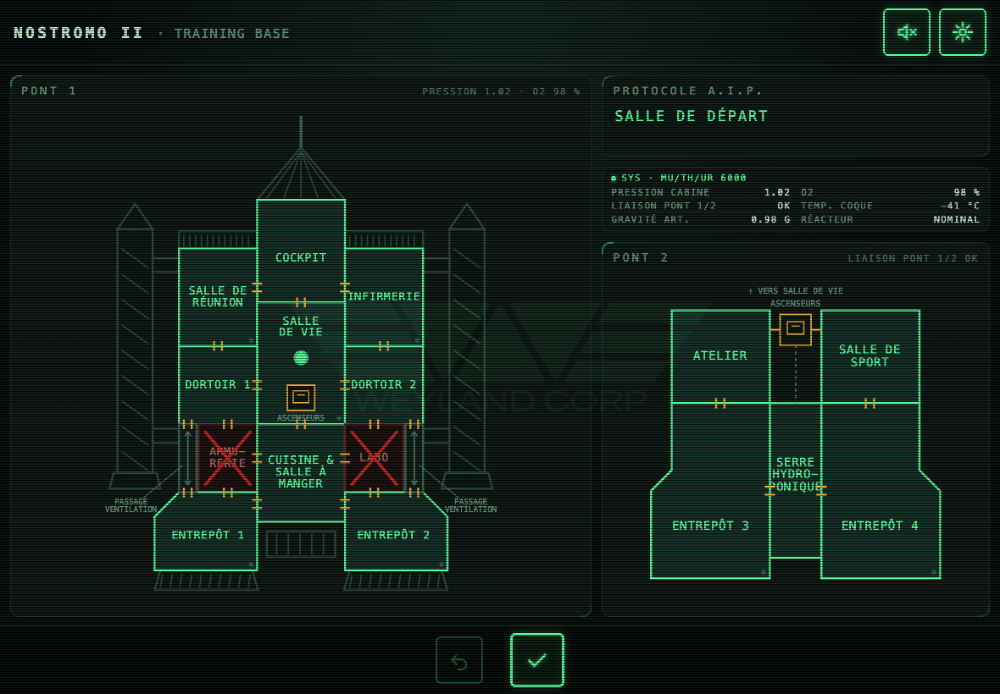

# Nostromo II – partie fusée (PWA)

[](https://github.com/dezande/nostromo-pwa/actions/workflows/tests.yml)
[](https://dezande.github.io/nostromo-pwa/)



Application web installable qui accompagne l'effet *Nostromo II* de Fred Darevil (Marchand de Trucs).
Elle affiche le plan du vaisseau-base sur deux ponts. Le Psychic Agent y place son pion et se déplace ;
le Coordinateur, qui suit sa fiche de protocole papier, touche les salles à fermer.

C'est une création de fan. Les protocoles ne sont **pas** inclus : on utilise les fiches et les cartes
physiques fournies avec l'effet.

**En ligne :** https://dezande.github.io/nostromo-pwa/

## Installer l'app (hors ligne)

Ouvrez l'adresse une première fois avec une connexion, puis :

- **iPhone / iPad (Safari)** : bouton Partager → « Sur l'écran d'accueil ».
- **Android (Chrome)** : menu ⋮ → « Installer l'application » (ou « Ajouter à l'écran d'accueil »).
- **Ordinateur (Chrome, Edge)** : icône d'installation dans la barre d'adresse.

L'app fonctionne ensuite sans connexion ; *Réglages → Système* indique si le mode hors ligne est prêt.
Les PDF et les polices des styles d'écran se téléchargent la première fois qu'on les utilise.

## Ce que fait l'app

- **Bilingue français / anglais** : sélecteur FR · EN sur l'accueil (et *Réglages → Affichage*). Au premier lancement,
  la langue du navigateur est choisie. Tout est traduit : interface, scénarios, contrat, plan, annonce vocale,
  et les documents à imprimer (pages `fiches/*-en.html`, PDF aux noms anglais générés par `npm run fiches`).

- **Trois scénarios**, au choix au lancement (« Démarrer », puis « Lancer ») ; le dernier choisi est proposé la fois suivante :
  - **Sixième sens** (par défaut ; joueur débutant, 20 à 30 min) : un Psychic Agent en formation sur la base lunaire Nostromo II.
    Panneau « Bienvenue à bord », puis quatre règles, chacune avec une scène animée tirée du vrai plan.
  - **Une simple formalité** (jeu de rôle ; joueur intermédiaire, 30 à 45 min) : un candidat postule à un poste très bien payé. Le RH lui fait lire
    un long contrat (qui défile, avec des passages censurés), qu'il signe en gardant le doigt posé sur
    un lecteur d'empreinte. Le Coordinateur lui fait ensuite passer « l'examen d'aptitude ».
  - **Session disciplinaire** (joueur confirmé, 30 min environ) : le joueur est le Lieutenant D.R. du livret, agent de la C.R.F. infiltré. Après ses
    archives, il découvre un e-mail de la direction : elle sait tout et l'envoie à l'entraînement
    pour le punir.
- **La partie** : choix de la salle de départ, déplacements (5 au plus, sans compteur), « Valider »,
  puis le Coordinateur touche une ou deux salles à fermer. La fermeture est immédiate : croix rouge,
  claquement, annonce vocale, cri du xénomorphe plus ou moins fort selon la distance.
  Huit fermetures, ou une seule salle encore ouverte, et c'est la fin : un rapport de la compagnie
  propre à chaque scénario, avec de faux numéros de document.
- **Documents à imprimer** (PDF noir et blanc, système de jeu de rôle
  [3D6 Système](https://3d6.ovh/) de François Cedelle, licence ORC) : fiches de personnage prétirées
  (recto verso et illustrées, lisibles en A4 comme en A5 ; un PDF pour la version homme, un pour la
  version femme, un pour l'aide du MJ) et guide du MJ pour chaque scénario, plus les cartes des
  petits rôles des spectateurs (format poker, neuf par page A4 : l'IA W.Y.C. TYCHE montre la carte et dit le
  nombre de déplacements, l'IA Protocole CERBÈRE annonce les salles qui ferment, un Xénomorphe par salle pousse
  le cri quand la sienne ferme, et deux Brutes (Sgt Voss, Cpl Brekke) gardent le Lieutenant D.R. dans la « Session disciplinaire »). Depuis l'écran de choix du scénario, on les lit directement dans l'app
  (texte remis au style de l'app, aussi hors ligne) ou on télécharge le PDF.
- **Réglages en onglets** :
  - *Affichage* : format tablette (deux ponts côte à côte) ou téléphone (un pont à la fois, avec
    onglets), six styles d'écran rétro sombres, taille du texte, lignes horizontales, écrans de
    transition, repère discret ;
  - *Audio* : musique (coupée par défaut), volumes, annonce vocale ;
  - *Alerte* : musique jouée pendant la partie (sirène, klaxon ou détecteur) ;
  - *Système* : écran toujours allumé, numéro de build et état du mode hors ligne.

- **Sources** (bouton livre de l'accueil) : crédits, inspirations et outils, avec un QR code pour ouvrir
  depuis un téléphone l'app, son code, Claude Code, l'effet Nostromo II, le 3D6 Système et cool-retro-term.

Musique et bruitages sont générés par le navigateur (Web Audio) : aucun fichier audio.

## Démarrer

Il faut [Node.js](https://nodejs.org) (version 20 ou plus).

```sh
npm install        # une seule fois
npm run dev        # serveur de développement : http://localhost:5173 (se recharge à chaque modification)
npm run build      # version finale dans dist/
npm run preview    # sert dist/ pour la tester (avec le mode hors ligne)
npm run typecheck  # vérification TypeScript
npm run test:unit  # tests Jest
npm run test:e2e   # tests Playwright
npm run fiches     # regénère les PDF de public/fiches/ (il faut être en ligne pour la police)
```

Pour tester sur un téléphone du même réseau Wi-Fi : `npx vite --host`, puis ouvrir l'adresse « Network »
affichée.

## Organisation du code

Le projet est écrit en [TypeScript](https://www.typescriptlang.org) avec [Vite](https://vite.dev),
[Preact](https://preactjs.com) (composants), [@preact/signals](https://preactjs.com/guide/v10/signals/) (état)
et [Sass](https://sass-lang.com) (styles).

```
src/
  main.tsx              point d'entrée
  App.tsx               assemblage de l'écran
  data/                 données et textes, sans code d'affichage
    ship.ts             salles, liaisons, positions sur le plan
    scenarios.ts        textes des trois scénarios : règles, rapports de fin
    contract.ts         contrat du scénario « Une simple formalité » ([[…]] = passage censuré)
    documents.ts        faux numéros de documents
    themes.ts           styles d'écran (inspirés de cool-retro-term)
    terminal.ts         textes des écrans de transition (MU/TH/UR 6000)
    sources.ts          sources et crédits de l'écran « Sources »
  state/                état et actions
    game.ts             partie : pion, déplacements, fermetures, fin
    settings.ts         réglages enregistrés dans le navigateur
    ui.ts               écrans ouverts (accueil, panneaux d'introduction, réglages…)
    deckView.ts         pont affiché au format téléphone
    terminal.ts         déroulement des écrans de transition
    device.ts           écran allumé, annonce vocale
    alert.ts            musique d'alerte pendant la partie
    pwa.ts              mode hors ligne et numéro de build
  audio/audio.ts        musique et bruitages
  components/           morceaux d'interface : plan, barre d'actions, fenêtre du protocole,
                        scènes des règles, logo Weyland Corp, passages censurés…
  screens/              écrans superposés : accueil, bienvenue et règles, « Une simple formalité » (RH, contrat,
                        empreinte), « Session disciplinaire » (archives, e-mail), fin, réglages
  styles/               Sass : un fichier par partie, réunis dans main.scss
  **/*.test.ts(x)       tests unitaires Jest, à côté du code testé
tests/                  tests de bout en bout Playwright
fiches/                 sources HTML des PDF (fiches de personnage, guides du MJ, cartes des rôles)
scripts/fiches.mjs      génération des PDF avec Playwright
public/fiches/          PDF publiés avec l'app
public/icons/           icônes de l'app
```

- Pour changer une salle ou une liaison : `src/data/ship.ts`.
- Pour changer un texte de scénario : `src/data/scenarios.ts` (et `contract.ts`, `screens/Recruitment.tsx`,
  `screens/Infiltrated.tsx` pour les panneaux d'introduction). Dans ces textes, `[[…]]` affiche un passage
  censuré (███) ; le texte caché n'est pas mis dans la page.
- Pour changer un PDF : modifier le fichier HTML de `fiches/`, puis `npm run fiches`. Le script s'arrête
  si une fiche déborde de sa page (ou une carte de rôle de sa carte).
- Les protocoles ne sont pas dans l'app : le Coordinateur utilise ses fiches papier et touche sur le plan
  la ou les salles à fermer.

## Version

Le numéro de build est calculé au moment du `build` : nombre de commits Git et identifiant du commit.
Il s'affiche dans *Réglages → Système*, avec l'état du mode hors ligne. La version se change dans
`package.json`.

## Tests

- **Jest** (`src/**/*.test.ts(x)`) : données (plan, liaisons, styles, scénarios), logique de jeu (pose du
  pion, déplacements, limites, fermetures, victoire, élimination), réglages, transitions et composants Preact.
- **Playwright** (`tests/`) : parcours complets dans un vrai navigateur, sur la version compilée, au format
  ordinateur et téléphone, pour les trois scénarios. Les tests sont silencieux (navigateur muet, voix
  désactivée). En local, ils utilisent le Chrome installé.

Sur GitHub, la vérification TypeScript et les deux séries de tests se lancent à chaque pull request
(`.github/workflows/tests.yml`).

## Contribuer

- Une branche par tâche, partie de `main`, et une pull request vers `main`. On ne pousse jamais
  directement sur `main`.
- Un commit par modification.
- En local, lancer seulement la vérification TypeScript et les tests liés à la modification ;
  la suite complète tourne sur GitHub.

## Publication sur GitHub Pages

`.github/workflows/pages.yml` publie le site à chaque fusion sur `main`, à l'adresse
https://dezande.github.io/nostromo-pwa/ (réglage du dépôt : **Settings → Pages → Source : GitHub Actions**).

## Sources et crédits

Le dépôt n'a pas de licence. *Nostromo II* est un effet de Fred Darevil, édité par Marchand de Trucs ;
*Alien*, Weyland-Yutani, Nostromo et les noms associés sont des marques de leurs ayants droit. Cette app
est une création de fan, sans lien avec eux.

Les mêmes sources s'affichent dans l'app (bouton livre de l'accueil), à partir de `src/data/sources.ts`.

**Cette app**

- [Nostromo II · partie fusée](https://dezande.github.io/nostromo-pwa/) : l'app en ligne, création de fan.
- [Code source](https://github.com/dezande/nostromo-pwa) : le code de l'app et des fiches, sur GitHub.
- [Claude Code](https://claude.com/claude-code) (Anthropic) : assistant IA qui a écrit le code, les textes et
  les fiches avec l'auteur.

**Inspirations**

- [*Nostromo II*](https://www.marchanddetrucs.com/magasin-de-magie/nos-produits/nostromo-ii.html) : Fred Darevil, Marchand de Trucs. L'effet que l'app accompagne : plan, protocoles et cartes.
- [3D6 Système](https://3d6.ovh/) : François Cedelle, licence ORC. Système de jeu des fiches, des guides du MJ
  et du tutoriel.
- [cool-retro-term](https://github.com/Swordfish90/cool-retro-term) : Swordfish90. Profils des styles d'écran
  et effets cathodiques.
- *Alien* : marques de leurs ayants droit (Weyland-Yutani, Nostromo et les noms associés).

**Outils**

- [Preact](https://preactjs.com) (MIT) : composants de l'interface.
- [Vite](https://vite.dev) (MIT) : compilation et mode hors ligne.
- [TypeScript](https://www.typescriptlang.org) (Apache 2.0) : langage du code.
- [Sass](https://sass-lang.com) (MIT) : styles.
- [uqr](https://github.com/unjs/uqr) (MIT) : QR codes de l'écran Sources.
- Polices : IBM Plex Mono, JetBrains Mono, Fira Code ([Google Fonts](https://fonts.google.com)) et Questrial
  (Fontsource).
